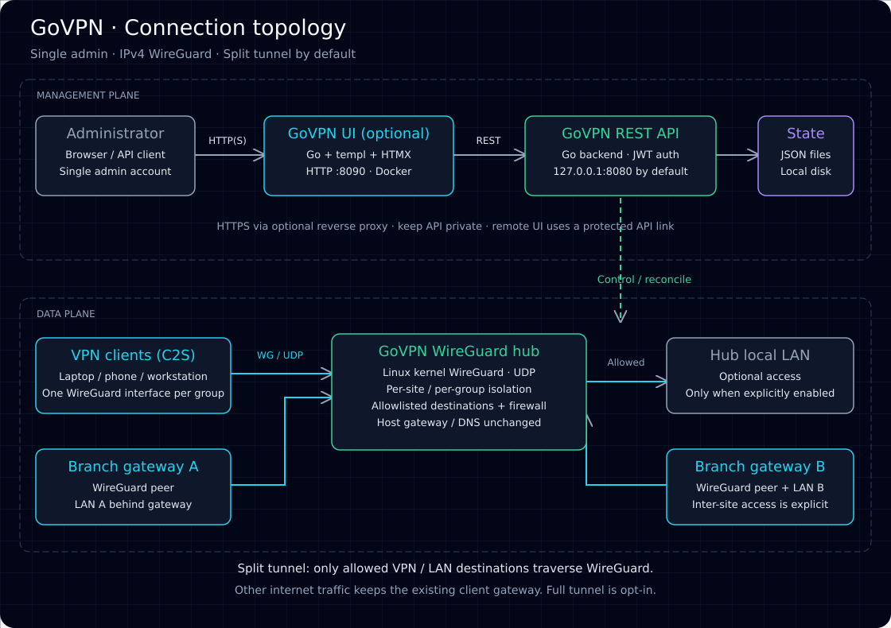
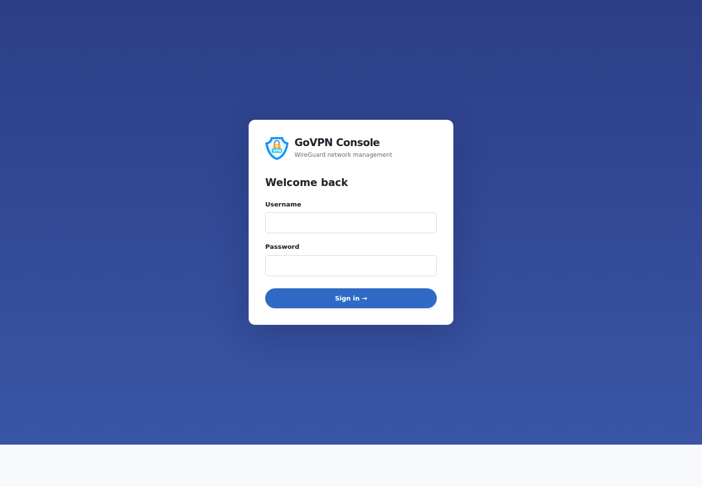
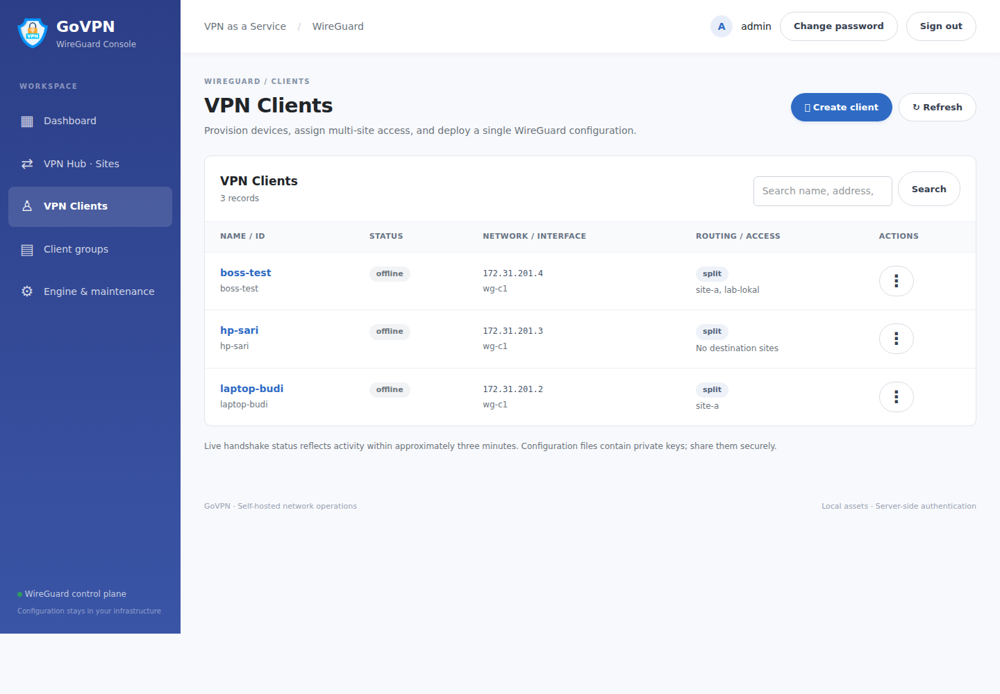
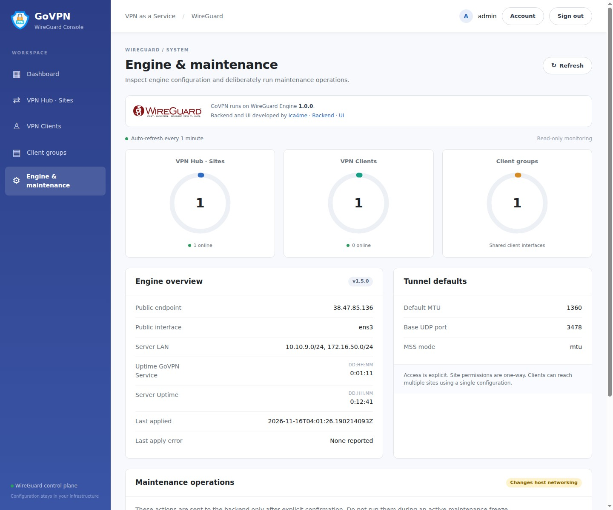

# GoVPN WireGuard UI

Web UI untuk mengelola [GoVPN WireGuard Backend](https://github.com/ica4me/govpn-wg): sites, groups, clients, dan konfigurasi VPN.

Dibuat dengan **Go + Templ + HTMX + Tailwind CSS**, dijalankan menggunakan Docker Compose.

## Topologi koneksi



UI bersifat opsional. Garis kontrol mengelola hub; trafik VPN lewat WireGuard. Default **split-tunnel**, akses antar-site dan LAN mengikuti izin yang dipilih.

## 1. Install tools dan Docker

Untuk server Linux Debian/Ubuntu baru:

```bash
sudo apt-get update
sudo apt-get install -y ca-certificates curl git nano
curl -fsSL https://get.docker.com -o get-docker.sh
# Baca script sebelum dijalankan.
sudo sh get-docker.sh
sudo systemctl enable --now docker
sudo docker compose version
```

**Jika dipasang pada server VPN/cloud yang sudah aktif**, ikuti [pengamanan Docker](docs/deployment.md#pengamanan-server-vpncloud) sebelum menjalankan installer agar jaringan host tidak terganggu. Jika Docker sudah tersedia, lewati instalasinya.

## 2. Clone dan edit Compose

```bash
git clone https://github.com/ica4me/govpn-wg-ui.git
cd govpn-wg-ui
nano compose.yaml
```

Edit nilai `environment` pada service `ui`:

**UI di server yang sama dengan backend:**

```yaml
environment:
  GOVPN_API_URL: 'http://127.0.0.1:8080/api/v1'
  GOVPN_UI_LISTEN: '127.0.0.1:8090'
  GOVPN_COOKIE_SECURE: 'false'
```

**UI di server terpisah dari backend:**

```yaml
environment:
  GOVPN_API_URL: 'http://10.0.0.10:8080/api/v1'
  GOVPN_UI_LISTEN: '127.0.0.1:8090'
  GOVPN_COOKIE_SECURE: 'false'
```

Ganti `10.0.0.10` dengan IP privat backend yang dapat dijangkau server UI. Backend harus listen pada IP tersebut; batasi akses API hanya dari server UI. Gunakan HTTPS atau jaringan privat terenkripsi untuk koneksi antarserver.

Untuk akses langsung saat pengujian, ubah listen menjadi `0.0.0.0:8090`, lalu buka `http://IP-SERVER-UI:8090`. Untuk produksi, gunakan reverse proxy HTTPS, tetap bind loopback, dan set `GOVPN_COOKIE_SECURE: 'true'`. Login memakai akun backend.

### Versi WireGuard di dashboard

Ambil versi **kernel module** sekali di server backend (bukan `wg --version`, yang merupakan versi tools):

```bash
modinfo -F version wireguard
```

Simpan hasilnya di file `.env` pada direktori Compose UI, misalnya `GOVPN_WIREGUARD_VERSION=1.0.0`. Untuk backend terpisah, jalankan perintah di host backend lalu salin hasilnya ke `.env` UI. Nilai ini dibaca saat UI mulai, tanpa polling versi. Perbarui snapshot setelah upgrade WireGuard. Jika modul bawaan kernel tidak menyediakan versi, isi label versi kernel yang terverifikasi; jangan menebak.

Logo dashboard disimpan lokal di `internal/console/static/wireguard.svg`, diambil dari [WireGuard](https://www.wireguard.com/img/wireguard.svg); tidak ada hotlink saat halaman dimuat.

## 3. Build dan jalankan

```bash
sudo docker compose build
sudo docker compose up -d
sudo docker compose ps
```

Update dan paksa buat ulang container:

```bash
git pull --ff-only
sudo docker compose up -d --build --force-recreate
```

## Ganti atau lupa login

Klik **Account** di kanan atas untuk mengganti username, password, atau keduanya. Setelah disimpan, semua sesi keluar dan kamu login lagi dengan data baru.

Kalau lupa username atau password, reset di **server backend**:

```bash
sudo /opt/govpn/wg/govpn-wg reset-admin
sudo systemctl restart govpn-wg
```

Login kembali menjadi **admin / admin**, lalu UI langsung meminta password baru. Tunnel dan data VPN tidak berubah. Detailnya ada di [dokumentasi backend](https://github.com/ica4me/govpn-wg/blob/main/docs/api/auth.md).

## Screenshot

### Login



### Dashboard


### VPN Hub / Sites


### VPN Clients



### Client groups


### Engine / Maintenance



## Dokumentasi

- [Deployment, backend terpisah, dan keamanan Docker](docs/deployment.md)
- [Fitur, konfigurasi, keamanan, dan development](docs/reference.md)
- [Hasil verifikasi awal](docs/verification.txt)
