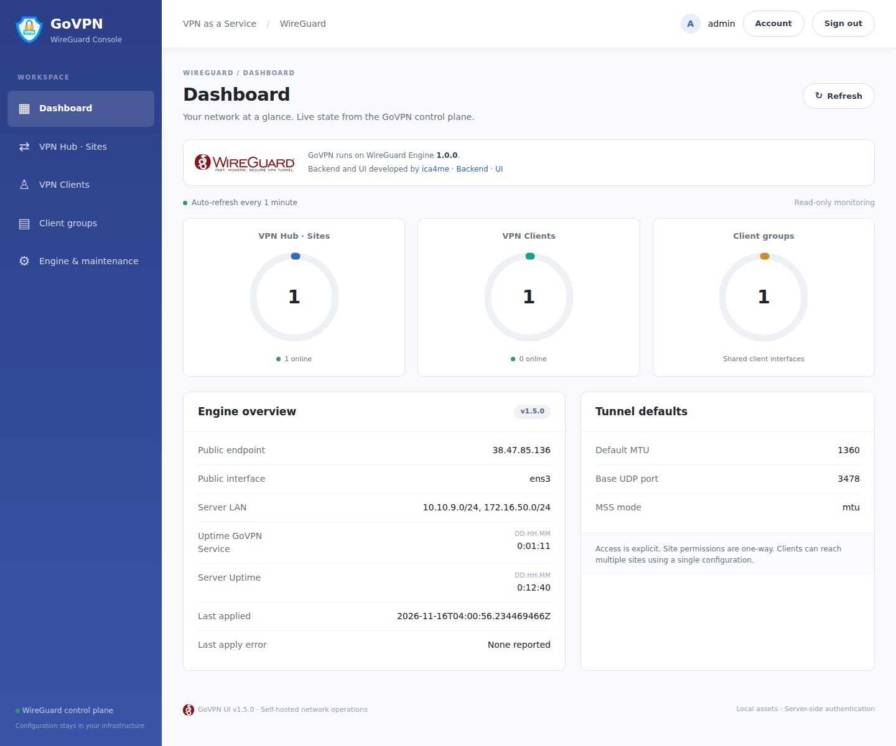
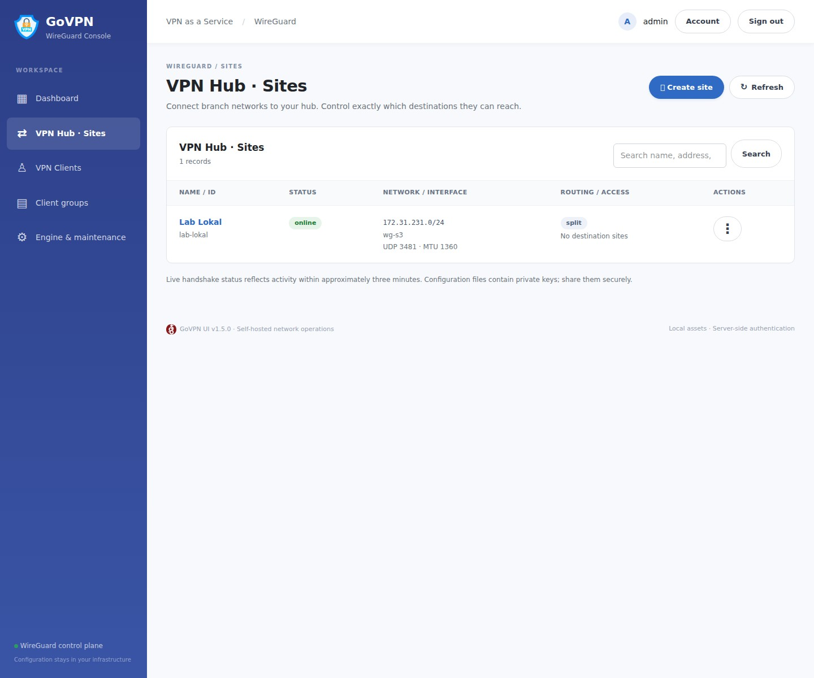
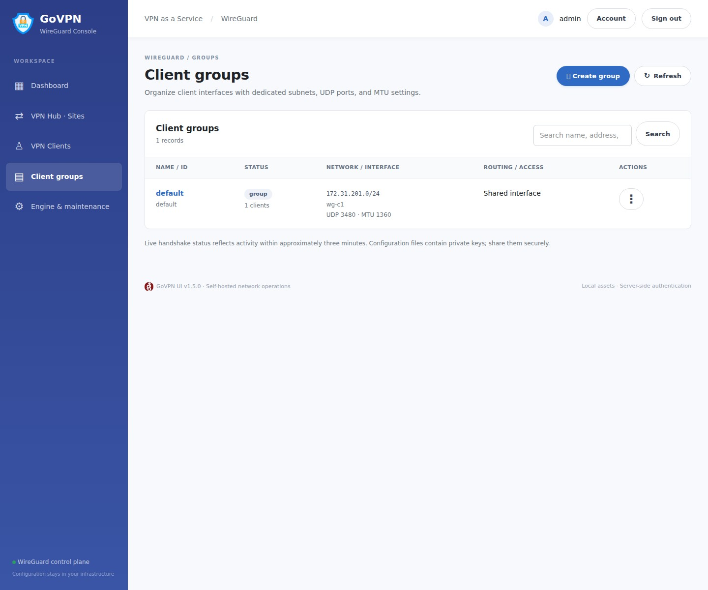

# GoVPN WireGuard UI

Web UI untuk mengelola [GoVPN WireGuard Backend](https://github.com/ica4me/govpn-wg): sites, groups, clients, dan konfigurasi VPN.

Dibuat dengan **Go + Templ + HTMX + Tailwind CSS**, dijalankan menggunakan Docker Compose.

## Topologi koneksi


UI bersifat opsional. Garis kontrol mengelola hub; trafik VPN lewat WireGuard. Default **split-tunnel**, akses antar-site dan LAN mengikuti izin yang dipilih.

## 1. Install tools dan Docker

Untuk server Linux Debian/Ubuntu baru:

```bash
sudo apt-get update
sudo apt-get install -y ca-certificates curl git nano
curl -fsSL https://get.docker.com -o get-docker.sh
# Baca script sebelum dijalankan.
sudo sh get-docker.sh
sudo systemctl enable --now docker
sudo docker compose version
```

**Jika dipasang pada server VPN/cloud yang sudah aktif**, ikuti [pengamanan Docker](docs/deployment.md#pengamanan-server-vpncloud) sebelum menjalankan installer agar jaringan host tidak terganggu. Jika Docker sudah tersedia, lewati instalasinya.

## 2. Clone dan atur akses UI

```bash
git clone https://github.com/ica4me/govpn-wg-ui.git
cd govpn-wg-ui
```

Pilih dulu **cara UI diakses**. Default-nya `127.0.0.1:8090` (loopback), artinya UI **hanya bisa dibuka dari server itu sendiri**. Kalau dibuka dari browser lain tanpa mengubah ini, halaman tidak akan terbuka.

Cara paling mudah tanpa mengedit `compose.yaml`: buat file `.env` di folder `govpn-wg-ui`.

**A. Akses langsung via `http://IP-SERVER:8090` (pengujian / jaringan privat):**

```bash
cat > .env <<'EOF'
GOVPN_UI_LISTEN=0.0.0.0:8090
EOF
```

Pastikan port TCP **8090** dibuka di firewall host dan firewall/security group provider cloud.

**B. Produksi (disarankan): lewat Nginx Proxy Manager (NPM) + HTTPS.**

Jangan arahkan NPM ke port `8080`: itu REST API backend, bukan UI. Target UI selalu port **8090**.

NPM biasanya jalan di container dengan jaringan bridge, jadi `127.0.0.1` di dalam NPM adalah container NPM itu sendiri, **bukan host**. Pakai IP gateway bridge jaringan NPM:

```bash
# nama jaringan NPM, mis. proxy-net
docker inspect npm -f '{{range $k,$v := .NetworkSettings.Networks}}{{$k}} {{$v.Gateway}} {{$v.IPAddress}}{{"\n"}}{{end}}'
# contoh hasil: proxy-net 172.18.0.1 172.18.0.5
```

Isi `.env` UI (ganti IP sesuai hasil di atas):

```bash
GOVPN_UI_LISTEN=172.18.0.1:8090        # gateway bridge NPM: tidak terbuka ke internet
GOVPN_COOKIE_SECURE=true                # wajib setelah diakses via https://
GOVPN_TRUSTED_PROXY_CIDRS=172.18.0.5/32 # IP container NPM (opsional, untuk rate-limit per IP asli)
```

Lalu `sudo docker compose up -d --force-recreate` dan cek `ss -ltnp | grep 8090`.

Di NPM → **Proxy Hosts → Add Proxy Host**:

- Domain: domain UI, mis. `govpn.example.com`
- Scheme `http`, Forward Hostname/IP `172.18.0.1`, Forward Port `8090`
- Aktifkan *Block Common Exploits*
- Tab SSL: *Request a new SSL Certificate* (Let's Encrypt), aktifkan *Force SSL* dan *HTTP/2*

Buka `https://govpn.example.com`. Kalau login kembali ke halaman login terus, berarti `GOVPN_COOKIE_SECURE=true` tetapi browser masih HTTP; atau kebalikannya. Detail rate-limit/allowlist ada di [docs/deployment.md](docs/deployment.md).

Alternatif tanpa domain: SSH tunnel dari laptop, `ssh -L 8090:127.0.0.1:8090 root@IP-SERVER`, lalu buka `http://127.0.0.1:8090` (pakai default listen loopback, `GOVPN_COOKIE_SECURE=false`).

**UI di server terpisah dari backend**, tambahkan juga di `.env`:

```bash
GOVPN_API_URL=http://10.0.0.10:8080/api/v1
```

Ganti `10.0.0.10` dengan IP privat backend yang dapat dijangkau server UI. Backend harus listen pada IP tersebut; batasi akses API hanya dari server UI. Gunakan HTTPS atau jaringan privat terenkripsi untuk koneksi antarserver.

Semua variabel (`GOVPN_API_URL`, `GOVPN_UI_LISTEN`, `GOVPN_COOKIE_SECURE`, `GOVPN_TRUSTED_PROXY_CIDRS`, `GOVPN_WIREGUARD_VERSION`) bisa diisi di `.env`; nilai default ada di `compose.yaml`. Login memakai akun backend.

### Versi WireGuard di dashboard

Ambil versi **kernel module** sekali di server backend (bukan `wg --version`, yang merupakan versi tools):

```bash
modinfo -F version wireguard
```

Simpan hasilnya di file `.env` pada direktori Compose UI, misalnya `GOVPN_WIREGUARD_VERSION=1.0.0`. Untuk backend terpisah, jalankan perintah di host backend lalu salin hasilnya ke `.env` UI. Nilai ini dibaca saat UI mulai, tanpa polling versi. Perbarui snapshot setelah upgrade WireGuard. Jika modul bawaan kernel tidak menyediakan versi, isi label versi kernel yang terverifikasi; jangan menebak.

Logo dashboard disimpan lokal di `internal/console/static/wireguard.svg`, diambil dari [WireGuard](https://www.wireguard.com/img/wireguard.svg); tidak ada hotlink saat halaman dimuat.

## 3. Build dan jalankan

```bash
sudo docker compose build
sudo docker compose up -d
sudo docker compose ps
ss -ltnp | grep 8090    # harus 0.0.0.0:8090 untuk akses langsung (opsi A)
```

### UI tidak bisa diakses?

- **`docker ps` tidak menampilkan port 8080/8090: normal.** Container UI memakai `network_mode: host`, jadi kolom PORTS selalu kosong. Port 8080 adalah backend `govpn-wg` (service systemd, bukan container) yang sengaja hanya listen di `127.0.0.1`.
- `ss -ltnp | grep 8090` menunjukkan `127.0.0.1:8090` → UI hanya loopback. Pakai opsi A atau B di atas, lalu `sudo docker compose up -d --force-recreate`.
- Domain NPM membuka JSON/401 atau `404 page not found` → NPM diarahkan ke `8080` (API). Ubah ke port `8090`.
- NPM `502 Bad Gateway` → Forward Host masih `127.0.0.1` (container NPM sendiri) atau UI tidak listen di IP gateway bridge.
- `curl http://127.0.0.1:8090/healthz` harus `200` di server. Kalau 200 di server tapi tidak bisa dari luar → port 8090 tertutup di firewall host/provider.
- Login gagal "backend unavailable" → cek `systemctl status govpn-wg` dan `GOVPN_API_URL`.

Update dan paksa buat ulang container:

```bash
git pull --ff-only
sudo docker compose up -d --build --force-recreate
```

## Ganti atau lupa login

Klik **Account** di kanan atas untuk mengganti username, password, atau keduanya. Setelah disimpan, semua sesi keluar dan kamu login lagi dengan data baru.

Kalau lupa username atau password, reset di **server backend**:

```bash
sudo /opt/govpn/wg/govpn-wg reset-admin
sudo systemctl restart govpn-wg
```

Login kembali menjadi **admin / admin**, lalu UI langsung meminta password baru. Tunnel dan data VPN tidak berubah. Detailnya ada di [dokumentasi backend](https://github.com/ica4me/govpn-wg/blob/main/docs/api/auth.md).

## Screenshot

### Login


### Dashboard



### VPN Hub / Sites



### VPN Clients


### Client groups



### Engine / Maintenance


## Dokumentasi

- [Deployment, backend terpisah, dan keamanan Docker](docs/deployment.md)
- [Fitur, konfigurasi, keamanan, dan development](docs/reference.md)
- [Hasil verifikasi awal](docs/verification.txt)
